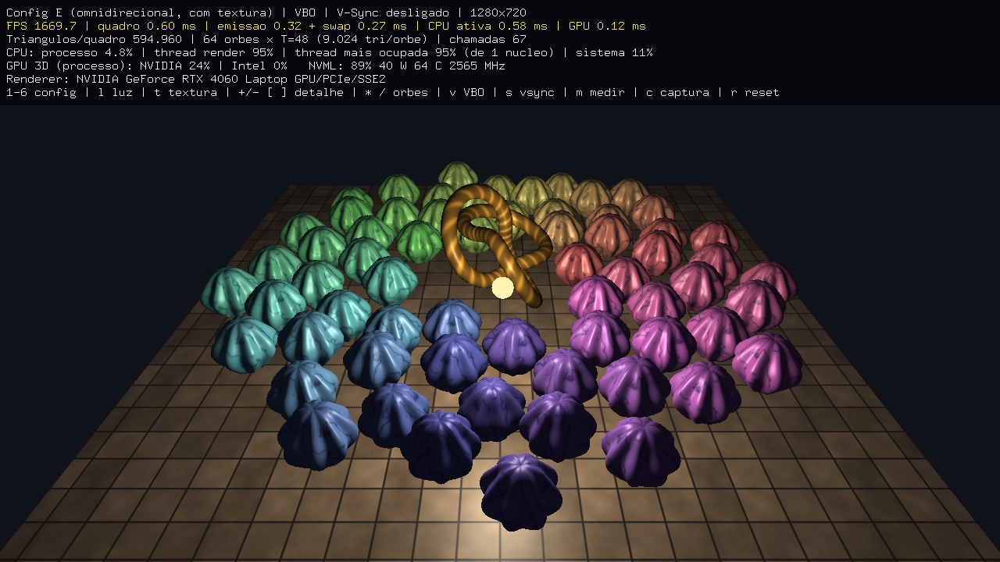
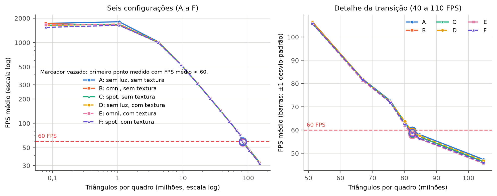

# Análise de desempenho de CPU e GPU com OpenGL/FreeGLUT

Atividade 3 da disciplina **Processamento Digital de Imagens** — Engenharia de Computação,
Escola Superior de Tecnologia da Universidade do Estado do Amazonas (EST/UEA).

**Autor:** Henrique da Silva Furtado  
**Professor:** Ricardo da Silva Barboza

📄 **Relatório técnico (PDF, com o código-fonte em anexo):** [`relatorio/Relatorio_Atividade3_Desempenho_CPU_GPU_OpenGL.pdf`](relatorio/Relatorio_Atividade3_Desempenho_CPU_GPU_OpenGL.pdf)

Uma única aplicação em C++/OpenGL/FreeGLUT com a cena original **"Jardim de Orbes"** — um nó
toroidal dourado girando no centro, cercado por N orbes de mármore em espiral filotáxica que giram
em carrossel — usada para medir como a quantidade de polígonos, a iluminação (nenhuma,
omnidirecional, spot; por fragmento em GLSL) e as texturas afetam o FPS e a utilização de CPU e
GPU, e para encontrar, em cada uma das seis configurações (A–F), a quantidade de triângulos em que
o **FPS médio cai abaixo de 60**.

<p align="center">
  
</p>

## Resultados

Menor quantidade testada de triângulos por quadro com **FPS médio abaixo de 60**
(janela 1280×720, V-Sync desligado, 3 repetições de 10 s por ponto, refino até 5%):

| Config. | E1 · VBO, RTX 4060 (principal) | E2 · modo imediato, RTX 4060 | E4 · VBO, Intel Arc integrada |
|---|---|---|---|
| A — sem luz, sem textura | **82.463.760** (59,8 FPS) | 524.304 (57,6) | 12.351.504 (58,8) |
| B — omni, sem textura | **82.463.760** (58,5 FPS) | 524.304 (56,8) | 12.351.504 (58,5) |
| C — spot, sem textura | **82.463.760** (58,4 FPS) | 501.776 (59,7) | 12.351.504 (58,6) |
| D — sem luz, com textura | **82.463.760** (59,3 FPS) | 501.776 (59,8) | 11.906.064 (59,6) |
| E — omni, com textura | **82.463.760** (57,9 FPS) | 501.776 (58,3) | 11.906.064 (59,1) |
| F — spot, com textura | **82.463.760** (58,8 FPS) | 501.776 (57,5) | 12.351.504 (58,7) |
| **Gargalo** | GPU (geometria) | CPU (1 thread) | GPU integrada |

No E1, todas as configurações ainda passam de 60 FPS com 80.155.664 triângulos. E3 (muitos
objetos pequenos, `T = 8`): o limite cai para ≈6 milhões de triângulos em ≈26 mil chamadas de
desenho, também limitado por uma thread da CPU.

- **A GPU limita o E1.** O tempo de GPU ocupa 99,8% do quadro, o motor 3D fica a 95–97% e a CPU
  do processo abaixo de 1%. O limite de 60 FPS coincide com a malha do orbe deixando de caber na
  cache L2 da GPU (>32 MB). Daí o tráfego de memória sobe de ~1% para 68%, a GPU atinge o limite
  de 60 W e o clock cai 10%.
- **Iluminação e texturas custam menos de 1%** na região limitada pela GPU, e até 3% no limite.
  Elas são calculadas por fragmento, e a janela tem só 0,92 milhão de pixels contra dezenas de
  milhões de triângulos.
- **O modo imediato desloca o gargalo para a CPU** e reduz o limite em 160 vezes: uma thread fica
  a 99% enquanto o processo usa só ~5% da CPU (1 de 22 threads).

<p align="center">
  
</p>

## Estrutura

```
.
├── CMakeLists.txt
├── build.bat                   # configura e compila no Windows (Visual Studio 2022)
├── executar_experimentos.bat   # capturas + experimentos E1..E4 + gráficos (~2h30)
├── src/
│   ├── gl_ext.h/.cpp           # carregador das funções OpenGL > 1.1 (shaders, VBO, timer query, V-Sync)
│   ├── malha.h/.cpp            # malhas de triângulos (orbe, nó, piso); VBO ou modo imediato
│   ├── texturas.h/.cpp         # texturas procedurais 1024² com mipmaps e anisotropia
│   ├── shaders.h/.cpp          # GLSL: 6 variantes (iluminação × textura), Blinn-Phong por fragmento
│   ├── cena.h/.cpp             # cena, animação, luzes, configurações A–F, contagem de triângulos
│   ├── monitor.h/.cpp          # CPU/thread/GPU/VRAM/potência (PDH, Toolhelp32, DXGI, NVML)
│   ├── benchmark.h/.cpp        # medição de quadros e protocolo automático (CSV)
│   └── main.cpp                # FreeGLUT, laço de quadros, painel, teclado, capturas
├── tools/graficos.py           # gráficos (resultados/graficos) e tabelas LaTeX (relatorio/gerado)
├── resultados/
│   ├── capturas/               # capturas das configurações A–F e do desenho em arame
│   ├── calibracao/             # medições preliminares e a da captura do Gerenciador de Tarefas
│   ├── dados/                  # CSV de cada repetição, de cada ponto e resumos + ambiente
│   └── graficos/               # gráficos em PDF e PNG
└── relatorio/
    ├── relatorio.tex
    ├── gerado/                 # tabelas e valores gerados por tools/graficos.py
    ├── figuras/                # capturas do Gerenciador de Tarefas e do painel
    └── Relatorio_Atividade3_Desempenho_CPU_GPU_OpenGL.pdf
```

## Configurações e contagem de polígonos

| Config. | Iluminação | Textura |
|---|---|---|
| A | nenhuma | não |
| B | omnidirecional (point light) | não |
| C | spot | não |
| D | nenhuma | sim |
| E | omnidirecional | sim |
| F | spot | sim |

Toda a geometria é feita só de triângulos indexados (`GL_TRIANGLES`), então a contagem é exata:

```
triângulos/quadro = 17.424 (piso + nó + lâmpada) + N · 4T(T − 1)
```

`T` = detalhe de cada orbe (T faixas × 2T colunas), `N` = número de orbes (uma chamada de desenho cada).

## Teclado

| Tecla | Ação |
|---|---|
| `1`…`6` | configuração A…F |
| `l` / `t` | alterna iluminação (nenhuma → omni → spot) / liga-desliga texturas |
| `+` `-` / `]` `[` | detalhe T dos orbes (passo 4 ou 16 / ±1) |
| `*` / `/` | número de orbes ×2 / ÷2 |
| `v` | VBO ↔ modo imediato |
| `s` | V-Sync |
| `w` / `p` / `h` | arame / pausa / painel |
| `m` | mede o ponto atual (3 × 10 s) e grava em `resultados/dados/manual_*.csv` |
| `c` | captura de tela |
| `r` ou `Home` | restaura a configuração inicial |
| `ESC` ou `q` | sai |

```bat
build\Release\desempenho_gl.exe                 :: modo interativo (GPU dedicada)
build\Release\desempenho_gl.exe --info          :: CPU, GPUs, versão do OpenGL e dispositivo usado
build\Release\desempenho_gl.exe --capturar      :: capturas do relatório
build\Release\desempenho_gl.exe --benchmark --rotulo teste --configs AF --valores 256,512
build\Release\desempenho_gl_integrada.exe       :: mesmo programa, sem pedir a GPU dedicada
```

> Execute a partir da raiz do projeto (os caminhos `resultados/` são relativos).

## Como compilar

Requisitos: Visual Studio 2022 (com CMake), **FreeGLUT 3.x** e, opcionalmente, **OpenCV 4.x**
(só para gravar as capturas em PNG; sem ele são gravadas em PPM). Para os gráficos:
Python 3 com `matplotlib`.

```bat
set FreeGLUT_DIR=C:\caminho\freeglut\lib\cmake\FreeGLUT
set OpenCV_DIR=C:\caminho\opencv\build
build.bat
executar_experimentos.bat
```

Relatório: `cd relatorio && pdflatex relatorio.tex && pdflatex relatorio.tex`.

## Ambiente de teste

Windows 11 Pro 25H2 · Intel Core Ultra 7 155H (16 núcleos / 22 threads) · 32 GB DDR5-5600 ·
NVIDIA GeForce RTX 4060 Laptop 8 GB (OpenGL 4.6, driver 621.01) + Intel Arc Graphics integrada ·
MSVC 14.44 (VS 2022) · CMake 3.31 · FreeGLUT 3.8.0 · OpenCV 4.14.0 · janela 1280×720, V-Sync desligado
